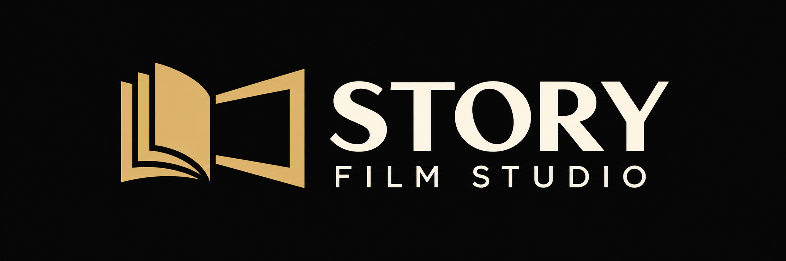
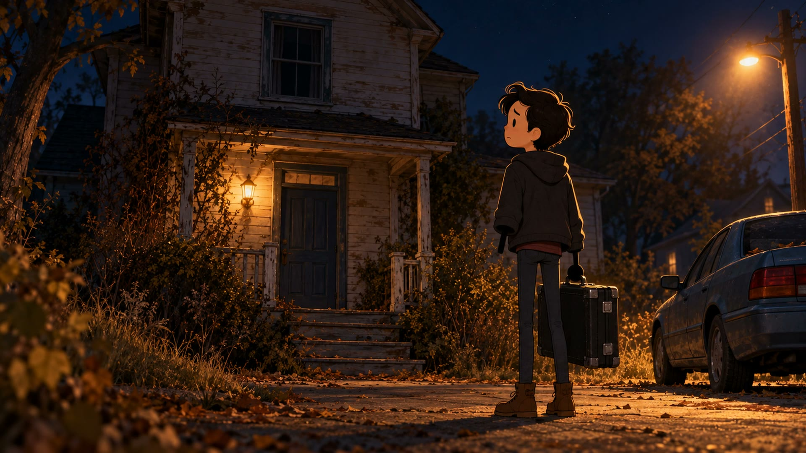
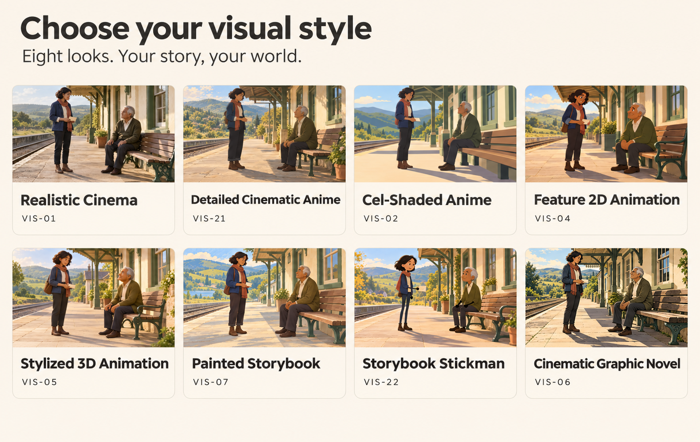
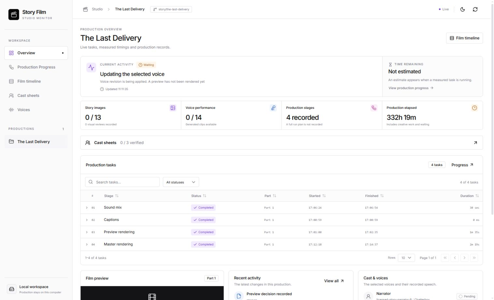
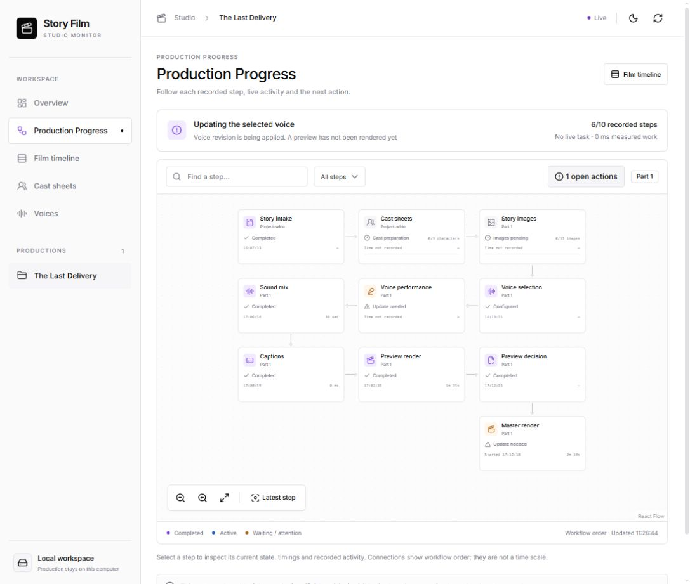

<p align="center">
  
</p>

<h1 align="center">Story Film Studio</h1>

<p align="center">
  Image-led storytelling, made simple.
  <br>
  Paste your story. Answer a few questions. Shape your film in chat.
</p>

<p align="center">
  <a href="#watch-a-film-made-with-the-studio">Watch the sample</a> ·
  <a href="#make-your-first-film">Make your first film</a> ·
  <a href="#questions-you-may-be-asked">Questions</a> ·
  <a href="#monitor-your-production">Progress dashboard</a>
</p>

---

Story Film Studio is an **AI-assisted story-to-video studio** for creating image-led films from written stories. It combines cinematic still images, narration, character dialogue, sound and captions into a finished video. Each image is planned for a moment in the story, with character and location references to help the film feel consistent.

**You bring the story; the agent handles the production work.** Paste your story, answer the important questions, and follow along as the agent develops the cast, creates images and assembles a preview. Want to change something? Say it in chat: refine a character, choose another voice, adjust a shot or change the pacing. Then watch the updated preview and decide when it is ready.

The film uses still images, with optional gentle camera movement. It does not automatically animate characters. The AI assistant needs access to the required tools, and setup, image generation and review take real time.

## Watch a film made with the studio

### The Last Delivery

A late-night delivery brings a man face to face with his past. Made with the studio in the **Storybook Stickman** style, with local Chatterbox voices, sound and English captions. **94 seconds · 1080p · 16:9**.

[](stories/the-last-delivery/parts/part_001/final.mp4)

**[▶ Watch The Last Delivery](stories/the-last-delivery/parts/part_001/final.mp4)** · [Read the story and project notes](stories/the-last-delivery/README.md) · [View credits and sources](stories/the-last-delivery/CREDITS.txt)

The image above is a frame from the actual film. The link opens the MP4 on GitHub; depending on your browser, you may need to download it to play it.

## From story to screen

**Share your story → answer a few questions → review your film.** The agent works through the details with you:

| Step | What happens |
| --- | --- |
| **1. Share your story** | Paste the complete story in chat, put it in `story.md`, or supply a text or Markdown attachment. Include the ending so the agent can plan the whole film. |
| **2. Choose the essentials** | Answer the missing questions about your output, visual style, voices, budget and privacy. Known preferences can be reused. |
| **3. Build the world** | The agent checks the story, plans scenes and designs a cast and references suited to the characters and their roles. |
| **4. Produce the film** | The agent creates and inspects shot images, prepares speech and sound, aligns captions and builds the timeline. |
| **5. Review and finish** | Watch and listen to the complete preview. Request changes or approve it; the agent can then render the master, perform playback checks and prepare the delivery. |

A single-film request produces **one complete video**. If you request a series of parts, the studio plans meaningful openings and endings and, unless you ask for parts only, also prepares a continuous full-film cut. A story-only or storyboard-only request can stop before film production.

## Make your first film

### 1. Fork and clone

Use GitHub’s **Fork** button to create your own copy. Clone your fork with the URL shown under its **Code** button, then open the cloned folder in your AI coding assistant.

You need Git and Python for story setup. The provided setup and commands below target **Windows with Python 3.12**; other systems need a separately verified Python, FFmpeg and speech setup. Node.js and npm are needed only if you want to build the dashboard. See [prerequisites and setup](docs/00-prerequisites.md).

> A public fork exposes its committed branches and history. Keep private stories, credentials and generated materials out of public repositories. Use a private workspace or repository for material you do not want to share.

### 2. Prepare the local tools

From PowerShell in your cloned repository:

```powershell
python tools/setup_studio.py
.\.venv\Scripts\python.exe tools/studio.py doctor
```

Setup creates a local Python environment and downloads the pinned runtime files and local speech assets. Check your disk space, network access and the [setup guide](docs/00-prerequisites.md) first. Other speech providers can require their own setup, account or credentials.

### 3. Give your story to the agent

Open the repository in Codex, or another coding assistant that can follow the repository instructions and use the required tools. Paste your complete story in chat, or save it in `story.md`. Then try:

```text
Read AGENTS.md, README.md and docs/13-fast-workflow.md.
My complete story is in story.md. Turn it into one full film.
Ask me the important missing questions together, then create the cast,
visuals, narration and a preview. Keep me updated in the dashboard.
```

You can include your preferred title, length, style, language, voice and budget in the same message. The agent should reuse what you already supplied instead of asking again. If the story is pasted directly into chat, ask the agent to preserve it exactly before starting.

With a supplied title, the studio initializes a separate `story/<story-name>` branch and `stories/<story-name>/` project. It does not automatically push your story. If you prefer the explicit command, run it **instead of** creating the project through chat:

```powershell
.\.venv\Scripts\python.exe tools/studio.py init "My Story" --story-file story.md --task film
```

The branch initializer preserves the original source and refuses to discard unrelated work. Use `studio resume` to return to an existing committed story; see [story branches](docs/15-story-branches.md).

### 4. Review and direct

Let the agent work through the story and production. The dashboard and chat show progress; you can ask for changes at any point. Once the complete preview is ready, watch and listen to it and give a clear decision. The final render and delivery follow that decision and the remaining checks.

Production can take time, especially when creating many images or using local speech. Results depend on the assistant, providers, hardware, available references and the quality of the source material. Some changes require regenerating affected images, speech or timing; unchanged work can often be reused.

## Questions you may be asked

The studio should bundle the important missing choices together and avoid repeating answers you have already given. Depending on your story and choices, expect questions like these:

| Topic | Examples |
| --- | --- |
| **Output and length** | One complete film, parts, a storyboard or story only? Is there a target duration, or is length flexible? |
| **Audience and performance** | Who is it for? What language, tone and narration or dialogue style should it use? |
| **Visual direction** | Which style, aspect ratio and visual references fit your story? Are there character or story details that must not change? |
| **Voices and sound** | Which speech provider or recordings do you want? Do you want captions, music or specific sound effects? |
| **Cost and privacy** | Which tools and uploads are allowed? What is the spending limit? If an image provider does not report a price, what call limit and unknown-charge scope do you accept? |
| **Creative decisions** | May the agent make small corrections that preserve the story? A major change or conflicting story detail needs your decision. |

You can answer in plain language. The studio records the actual authorized tools, spending and upload scope for that story. It should ask again only when a meaningful new decision or change of scope is needed. **Fast** is the default for new projects; [Strict mode](docs/01-workflow-and-approvals.md) keeps individual stage approvals.

## Shape the film in chat

You do not need to know the internal file structure to give direction. For example:

- “Make the detective look older and give her a more confident posture.”
- “Keep the same cast, but make the setting feel more rain-soaked and tense.”
- “Change the narrator’s voice and make the dialogue more conversational.”
- “The opening feels slow. Tighten the pacing without changing the ending.”
- “Show me the cast sheets and the latest preview.”

The agent should preserve prior versions, track changes to recurring characters and locations, and rebuild affected assets. For new provider costs, uploads outside the agreed scope, or major story changes, it needs your decision first. Final quality still requires real visual, audio, subtitle and playback checks; a generated file alone is not proof of quality.

## Image generation and visual consistency

The studio uses a selected visual direction, story-specific cast sheets and recurring location references to help keep characters and settings consistent. The agent plans shots around story beats, action and emotion; there is no fixed number of images per minute. You can choose a custom look or browse the [visual preference gallery](references/style/visual-preferences/README.md).

[](references/style/visual-preferences/README.md)

This illustrated overview is a guide. Open the [visual preference gallery](references/style/visual-preferences/README.md) to view and choose the original reference images.

**Codex and Antigravity:** the creator has tried both and found Codex produced more consistent images in their own use. Your results may differ with the model, references and prompts. The included image-job bridge currently targets Codex’s `image_gen.imagegen` tool; using Antigravity or another assistant requires checking its available image tools and handling image generation/import through the supported workflow. Do not assume either tool is available, free, or able to use every reference automatically.

## Voices, sound and captions

Choose the voice route that fits your story and budget: local **Kokoro** or **Chatterbox**, **ElevenLabs**, **Inworld**, **Cartesia**, a compatible custom gateway, or recordings you provide. Local and cloud options have different setup, language, cost and privacy requirements; a paid service is never silently substituted. The agent can cast different voices for speaking characters and preserve those choices across the film. See [speech providers](docs/14-speech-providers.md) and [voice casting](instructions/voice-casting.md).

The studio can mix authorized sounds and create subtitles, but the actual voices, pronunciation, captions, sound levels and source rights still need review. The included automatic alignment is English-oriented; other languages need a compatible aligner or inspected manual timing.

## Monitor your production

The studio includes a **local monitoring dashboard** so you can follow your film without digging through files. It shows the records available for your project: current activity, completed and pending steps, timing, the film timeline, cast sheets, voices and previews when available. Select a production step to see its details and recorded activity. Estimates appear only when enough measured information is available.



*The overview brings your current activity and task history together.*



*Production Progress shows the recorded workflow; select a step in the dashboard for more detail.*

These screenshots use a copy of **The Last Delivery** project. Some source assets and records are not present in the public copy, so the statuses shown are examples of that copy and do not describe the delivered film’s final status.

### Ask your assistant to open it

You can simply say this in your Codex or Antigravity chat:

```text
Start the local Story Film Studio monitor so I can see my story’s progress.
Build the dashboard first if needed, open it in my browser, and tell me the address.
```

Your assistant needs local command and browser access to do this. The monitor displays progress; **it does not create a film or start an image or speech provider**. Keep directing production and giving preview feedback in chat. The cast screen can also record a character-change request for your agent; it does not apply that change or begin generation on its own.

### Start it yourself

You need Node.js 22.12 or newer to build the dashboard. From PowerShell in the repository root, run the first two commands once, then start the monitor:

```powershell
npm --prefix apps/monitor ci
npm --prefix apps/monitor run build
.\.venv\Scripts\python.exe tools/studio.py monitor --workspace .
```

Open the local address printed in the terminal and leave the command running while you monitor. Rebuild after frontend changes. For a terminal snapshot instead, run:

```powershell
.\.venv\Scripts\python.exe tools/studio.py status stories/my-story
```

See [monitor setup](docs/16-progress-monitor.md) for watching other worktrees, connection details and status meanings.

## What you receive

The requested delivery can include the final MP4, narration and mix audio, subtitles, images, storyboard, timeline and production/QA records. Actual files depend on the configuration and completed work. The studio preserves delivery revisions and uses a real preview decision before the master and export.

## About this repository

Story Film Studio was developed and tested in a private workspace before this public release. This repository starts with a clean public snapshot, so its initial commit does not represent the full development and testing history. The Last Delivery is included as a sample project; private stories and credentials are kept separate.

## Frequently asked questions

### Can I turn a written story into a video with AI?

Yes. Give the assistant your complete story and your preferences. The studio guides the agent through story planning, character references, AI-generated still images, voice, sound, subtitles and video assembly. You review the complete preview before final delivery.

### Is this an AI video generator or an image-led film maker?

It is an image-led film making workflow: the finished video is assembled from still images and audio, with optional gentle camera movement. It does not automatically generate animated character performances or continuous AI video clips.

### Can I make a story video with Codex or Antigravity?

You can work through the studio with an assistant that can follow the repository instructions and access the necessary tools. The included image-generation bridge targets Codex; an Antigravity workflow depends on its available image tools and a compatible import process. See [image generation and visual consistency](#image-generation-and-visual-consistency).

### Can I use local voices or my own narration?

Yes. Supported speech routes include local Kokoro and Chatterbox as well as cloud providers, compatible gateways and imported recordings. Each route has its own setup, language support and privacy requirements. See [speech providers](docs/14-speech-providers.md).

### Does it make short films and longer stories?

The studio supports a single film, multiple parts, a storyboard or story-only work. The agent plans the number of images around the story rather than a fixed per-minute quota. Actual running time and production time depend on the story, chosen voices, tools and hardware.

## Learn more

- [Start-here prompt](START_HERE.md) · [Fast workflow](docs/13-fast-workflow.md) · [Story-to-film journey](docs/11-story-to-film-journey.md)
- [Visual preferences](references/style/visual-preferences/README.md) · [Cast sheets](docs/18-cast-sheets.md) · [Shot planning](instructions/shot-planning.md)
- [Speech providers](docs/14-speech-providers.md) · [Monitor setup](docs/16-progress-monitor.md) · [Commands and tools](tools/README.md)
- [Story branches and resume](docs/15-story-branches.md) · [Setup and requirements](docs/00-prerequisites.md) · [The Last Delivery credits](stories/the-last-delivery/CREDITS.txt)
