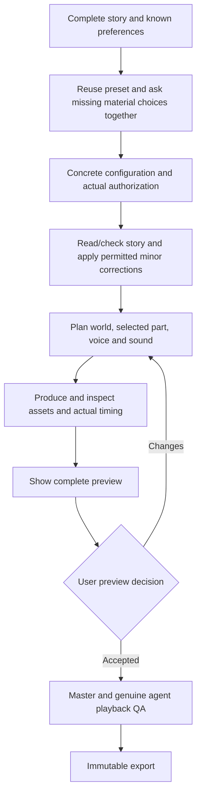

# From story to finished film

Default: **configure once, review the complete preview, receive the finished film**. Codex performs creative work and inspection; local tools handle recorded scope, media jobs, caching and export. There is no fixed production-time promise or default video duration.

After cloning and pasting a story, its supplied title starts a new `story/<safe-title-slug>` branch and matching project automatically through the agent. Source bytes are preserved before the existing intake/review continues. [Story branches](15-story-branches.md) describes isolation, saved progress and resuming the same story; it adds no separate creative approval.

Ask for missing material settings, unresolved creative decisions, changed expense/privacy scope, a failure requiring an alternative, or the preview decision. Reuse known decisions and record sufficient existing authorization without asking again. Internal inspections are agent tasks.

## Intake and review

Supply the entire story including its ending, or explicitly define limited scope. Include known output/length, language/performance, look/frame, subtitles, sound and constraints. A rough outline is welcome; a blank form is not a story. Story-only tasks skip media questions and production.

Missing choices usually fit in one message: one video/parts and length flexibility; language/performance; visual/frame preferences; tools/budget/uploads. Discuss protected details only when unclear. Show the [curated style chooser](../references/style/visual-preferences/README.md) when useful and reuse existing exact selections. Its people and setting are not story canon.

A stated full-length request goes directly to one complete film; ask only unknown settings. New part-by-part requests include individual videos and a continuous full-film cut unless parts only is requested. Record that scope once with `mode` and `continuous_edition`; single mode always means one full video. Existing unspecified projects are not silently expanded.

Reuse the user's named speech provider and voices. When undecided, show [free/local and cloud options](14-speech-providers.md) together with the existing configuration questions; no paid service is mandatory. Cast each speaking character explicitly and keep its voice across parts/full cut. Provider/language availability, local alignment, privacy and costs are checked for the chosen route.

The agent selects a narrator for the complete story's viewpoint, tone, audience and emotional range, using actual representative auditions when necessary and recording the choice reason. Character voices fit their roles. A later user voice change is recorded within the existing scope without repeating full intake/configuration; previous profiles remain available and only affected audio/timing/preview/full-cut work is rebuilt. [Casting and changes](../instructions/voice-casting.md) explains the listening and recovery steps.

Read the complete source, preserve it and map each scene. Check twelve areas and cross-check risky details. Keep evidence internally and present genuine findings concisely. Full A–I review remains available when requested or justified by complexity. Minor edits require actual matching delegation; major plot/twist/ending changes require permission first. Keep complete revisions/change logs and current checks.

## Continuous work and preview

Inventory whole-story dependencies and create canonical references needed by actual shots. Design the cast for its story roles, history, personality and emotional/action needs; preserve recognizable identity across the whole film. For parts, write the complete narrative in part sections first, including opening hooks, earned endings, continuation promises and where the next part pays them off. Then detail and produce each selected part in order with shared canon. Reuse a suitable configured voice; audition a changed/uncertain choice. A representative scene can resolve visual/performance uncertainty early inside scope.

Create/import actual speech, align measured words, preserve action/silence/tails, obtain suitable stills/audio, inspect and mix/subtitle on one part clock. An image queue is an internal tool action: execute, import, inspect and resume. It is not another user signoff.

Review the complete preview for story, pacing, performance, visuals and sound. The decision binds to content shown; changed content needs a changed preview. The agent still checks actual image/crop/state, sound rights/listening, alignment and final playback. A successful process or user preview decision does not replace those checks.

## Delivery and modes

Receive MP4, narration WAV where used, mix WAV, requested SRT, images/storyboard/timeline, relevant references/provenance, original/revision evidence, authorization/preview/playback records, QA and a checksummed manifest with exact paths. Deliveries use immutable revisions. Single mode supplies one complete film. Multipart mode supplies the configured part videos and full film; when included, the continuous edition is completed with its own measured edit, clean joins, rebuilt audio/subtitles and full playback QA before the task is finished.

[Fast workflow](13-fast-workflow.md) documents presets, authorization, preview decisions and recovery. Presets contain preferences and selected treatment snapshots, never another story's canon or permissions. Existing projects without a workflow record remain Strict. [Strict](01-workflow-and-approvals.md) keeps the full audit and G1–G6 signoffs. Both modes retain genuine quality/release checks.
