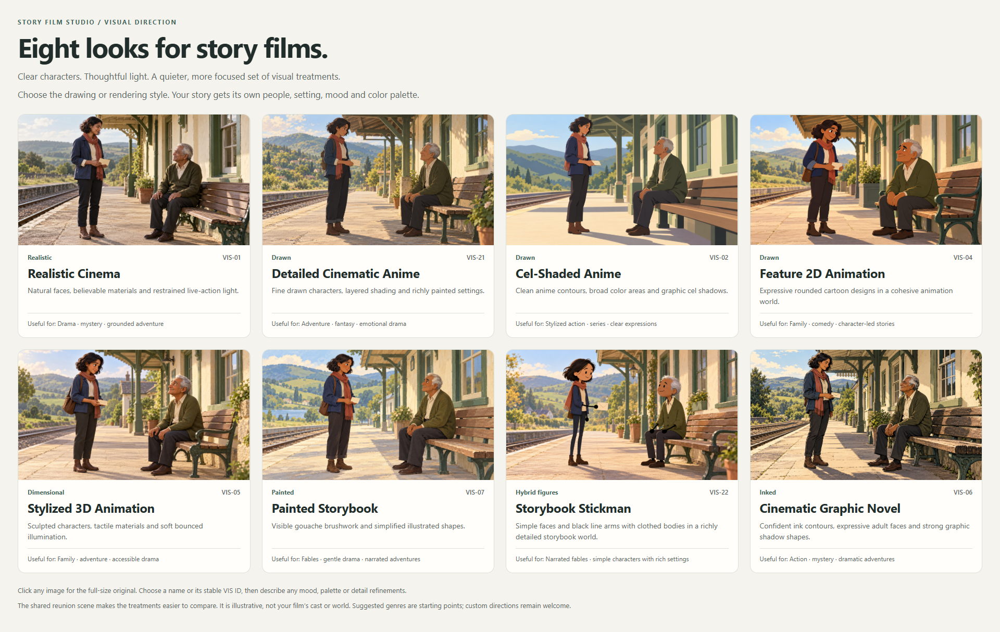

# Visual direction library

[Choose among eight curated story-film looks](visual-preferences/README.md), or describe a custom direction. The active set contains new examples of Realistic Cinema, Detailed Cinematic Anime, Cel-Shaded Anime, Feature 2D Animation, Stylized 3D Animation, Painted Storybook, Storybook Stickman and Cinematic Graphic Novel.

The same broad reunion scene makes drawing/rendering choices comparable. Choose a name or stable VIS ID and refine the mood, palette, lighting or detail. The scene's cast and setting are illustrative and never inherited as story canon. The full-size [offline gallery](visual-preferences/gallery.html) and [catalog](visual-preferences/style-catalog.json) accompany the actual images.

Snapshot only the chosen treatment with its exact hash. Preserve an existing story/preset's prior selection even when its example is retired from the primary chooser; use [migration provenance](visual-preferences/generation/migration-map.json) to recover the exact original if necessary. Never silently remap an old ID or overwrite story canon with a refreshed global example.

The curated set is a starting point, not a whitelist. Manga, pixel art, minimal line figures, craft looks and other treatments remain custom options. Define their actual scene language and provider fit with the author. Global references do not establish a story-specific approval, provider upload permission or commercial rights.
