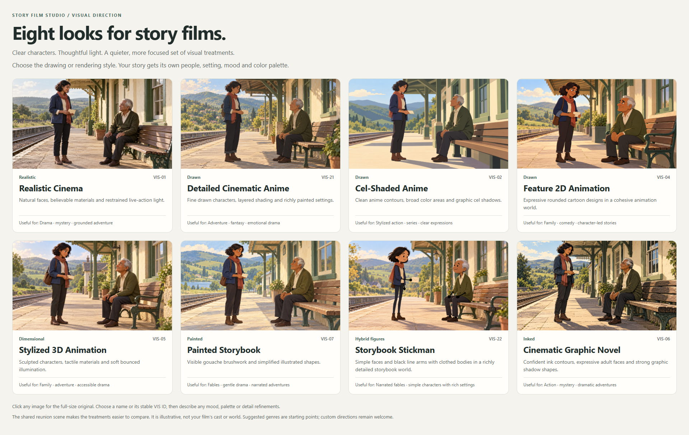

# Choose a visual direction

**Eight curated looks for story films.** Every active example has been replaced with new artwork focused on readable expressions, calm staging, restrained color and a clear visual medium.

[Open the full-size gallery](gallery.html). Click an image for its original PNG, or choose by descriptive name/stable ID.

| ID | Visual direction | What distinguishes it | Useful starting point |
|---|---|---|---|
| **VIS-01** | [Realistic Cinema](images/realistic-cinema.png) | Natural faces, believable materials and restrained live-action light. | Drama · mystery · grounded adventure |
| **VIS-21** | [Detailed Cinematic Anime](images/detailed-cinematic-anime.png) | Fine drawn characters, layered shading and richly painted settings. | Adventure · fantasy · emotional drama |
| **VIS-02** | [Cel-Shaded Anime](images/cel-shaded-anime.png) | Clean anime contours, broad color areas and graphic cel shadows. | Stylized action · series · clear expressions |
| **VIS-04** | [Feature 2D Animation](images/2d-cartoon.png) | Expressive rounded cartoon designs in a cohesive animation world. | Family · comedy · character-led stories |
| **VIS-05** | [Stylized 3D Animation](images/stylized-3d.png) | Sculpted characters, tactile materials and soft bounced illumination. | Family · adventure · accessible drama |
| **VIS-07** | [Painted Storybook](images/painted-storybook.png) | Visible gouache brushwork and simplified illustrated shapes. | Fables · gentle drama · narrated adventures |
| **VIS-22** | [Storybook Stickman](images/storybook-stickman.png) | Simple faces and black line arms with clothed bodies in a richly detailed storybook world. | Narrated fables · simple characters with rich settings |
| **VIS-06** | [Cinematic Graphic Novel](images/graphic-novel.png) | Confident ink contours, expressive adult faces and strong graphic shadow shapes. | Action · mystery · dramatic adventures |

Start with Realistic Cinema for grounded live-action storytelling, Detailed Cinematic Anime for drawn adventure/drama, or Stylized 3D Animation for an expressive dimensional world. The other choices offer flatter anime shadows, rounded 2D cartoon design, visible painted illustration, simple characters against rich scenery or bold graphic-novel inks. These suggestions are not genre restrictions.

## Choose and refine

Say “Detailed Cinematic Anime, with cooler night colors” or “Painted Storybook, with simpler backgrounds.” Choose only the treatment you want; mood, palette, lighting, detail and setting are adapted to your story. The hopeful country-station scene is a comparison example, not a mandated theme or default world.

The former 22-choice menu is now a lean eight-choice primary gallery. Manga, pixel art, minimal line figures, craft media and other directions remain valid custom requests. Retired examples are not silently substituted into an existing story, and retired IDs are not reused for unrelated styles.

Storybook Stickman (VIS-22) is the exact hybrid example requested by the user: simple rounded faces and black line arms, clothed bodies/legs and a rich environment. It is distinct from Minimal Line Stickman, where figures and the surrounding world use minimal line construction.

[Observed treatment traits](fidelity.json) bind each current example to its exact image hash. They describe the actual accepted pixels for prompt creation, without copying the sample cast, station, daylight or palette. VIS-22's historical generation prompt requested line legs; the accepted example has clothed legs and line arms. Preserve the original prompt as provenance and use the accepted appearance for new work, with any explicit story-specific refinements recorded in the visual bible.

## Use in a project

Snapshot only the chosen image and record its name/ID, exact file SHA-256 and role **visual treatment only**. Preserve existing story/preset snapshots. An old ID or filename alone is not enough to reinterpret a past preference; recover its exact prior bytes using [the migration records](generation/migration-map.json) if needed. The sample’s actors, letter, station and pose do not become your story canon. Story-specific references still need actual production-context review.

Reference-sheet and final-shot requests include numbered image roles and verify selected snapshot hashes. Map multiple historical choices explicitly through the style registry's `inspiration_paths`; they are not all automatically uploaded. See [exact bindings and prompt inspection](../../../docs/04-visual-and-prompts.md#exact-reference-bindings-and-current-prompts).

## Provenance and review

[Catalog](style-catalog.json) · [File manifest](manifest.json) · [Exact prompts and actual results](generation-records.json) · [Scene brief](scene-brief.md) · [Image review](asset-review.json) · [Browser checks](gallery-review.json)

The built-in `image_gen.imagegen` tool produced eleven images during the refresh; eight are now selected and three remain unselected studies. The Storybook Stickman example was included from the user’s exact attachment; its decoded pixels match the earlier generated result, while its PNG encoding differs. No new generation call was made for this addition. Every selected image was visually inspected; browser/layout checks are recorded separately. Images are raster PNGs, with actual dimensions in the manifest. No output-size promise, universal aesthetic suitability or story continuity guarantee is inferred from a prompt. Model identifier, seed, actual cost and independently verified commercial rights were not reported and are not invented.
